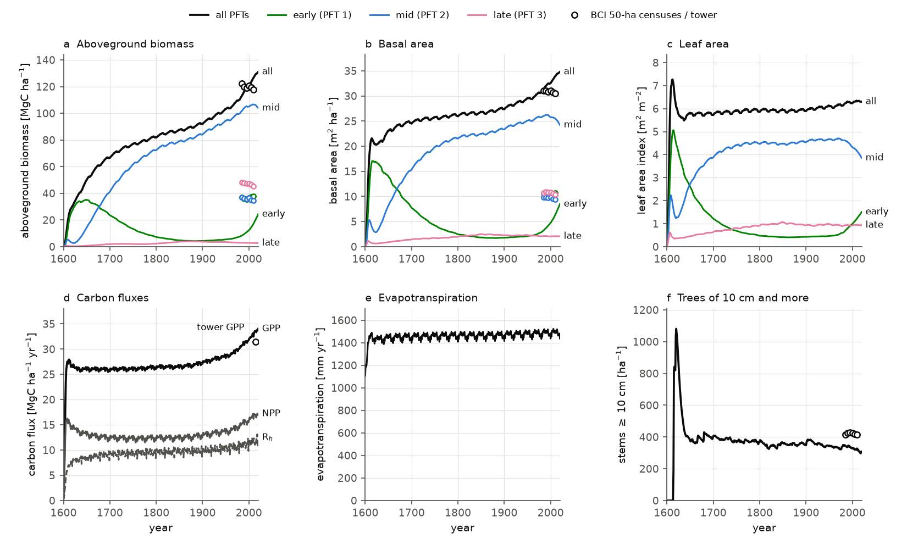
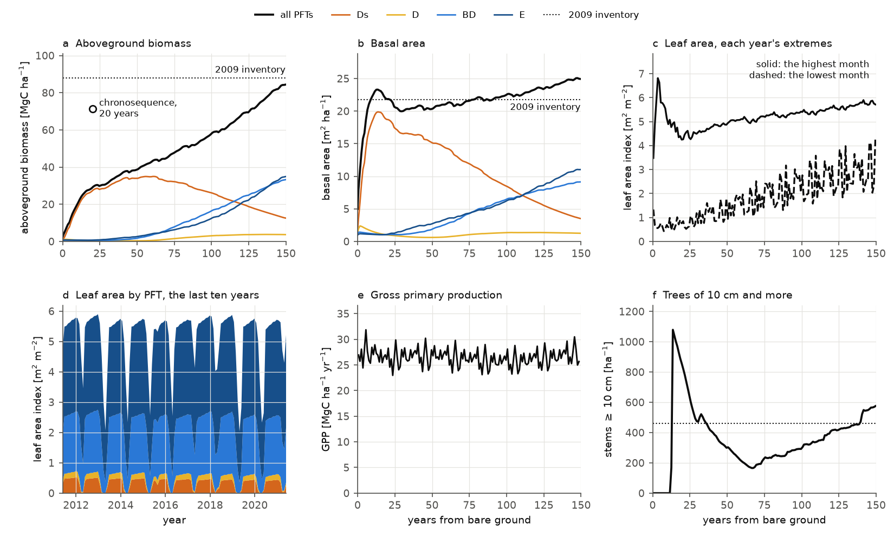

# Example 05 — Forest regeneration (Barro Colorado Island and Palo Verde)

The whole model at once: two tropical forests regrowing from bare ground on ERA5-Land weather and the
CO₂ of its history. The column of [example 04](../example04_column_biophysics/README.md) — canopy
radiation, leaf gas exchange, energy balances, plant hydraulics, soil water and heat — runs every 15
minutes in every patch; carbon allocation, growth, mortality, recruitment and treefall run every day,
month and year, as in [example 03](../example03_demography/README.md) but on the carbon the column
fixes.

1. **Barro Colorado Island (BCI), Panama**, a moist forest, 1600–2020: three successional PFTs, driven
   from Python through [`meds.model.Run`](../../python/meds/model/_run.py), the same steps `meds_main`
   takes.
2. **Palo Verde, Costa Rica**, a seasonally dry forest, 150 years: Xu et al. (2016)'s four leaf
   habits, set against the plots' 2009 inventory and run with `meds_main`.
   [Example 06](../example06_regional_run/README.md) runs the same PFTs across Central America.

## 1. Barro Colorado Island, 1600–2020

Three PFTs, early, mid and late successional, compete for light.



Aboveground biomass and basal area by PFT, leaf area, the carbon fluxes, evapotranspiration and the
trees of 10 cm and more, against the 50-ha plot's censuses (circles) and the BCI tower's GPP.

The 420-year run, this figure and its results below were made with v0.3.4; they were not repeated
after the 2026-10 sweep.

### Results

| year | AGB [MgC ha⁻¹] | early / mid / late | basal area [m² ha⁻¹] | LAI | trees ≥ 10 cm ha⁻¹ | GPP / NPP [MgC ha⁻¹ yr⁻¹] |
|---|---|---|---|---|---|---|
| 1650 | 48.2 | 33.8 / 13.6 / 0.7 | 22.3 | 5.8 | 403 | 25.6 / 12.7 |
| 1700 | 64.7 | 23.6 / 39.2 / 1.8 | 23.8 | 5.7 | 377 | 25.5 / 11.9 |
| 1800 | 79.5 | 8.7 / 67.4 / 3.5 | 25.1 | 5.8 | 376 | 25.9 / 11.9 |
| 1900 | 89.6 | 6.0 / 79.5 / 4.1 | 26.6 | 5.8 | 379 | 26.9 / 12.5 |
| 1950 | 101.0 | 7.0 / 90.6 / 3.4 | 28.7 | 6.0 | 359 | 28.1 / 13.2 |
| 2010 | 123.3 | 24.9 / 95.4 / 3.0 | 33.2 | 6.2 | 332 | 32.2 / 16.0 |
| 2020 | 127.4 | 33.4 / 91.3 / 2.8 | 34.2 | 6.2 | 307 | 33.8 / 17.0 |
| census 2010 | 117.9 | 37.9 / 34.6 / 45.4 | 30.5 | | 416 | 31.3 (tower) |

Yearly values. The census is the 50-ha plot's 2010 census on the model's allometry (example 03's
[`census_stand.csv`](../example03_demography/census_stand.csv)); the tower's GPP is example 04's,
2012–2017, corrected for its low bias.

- **The early PFT takes the bare ground, the mid PFT the forest.** The early PFT holds 70 % of the
  biomass in 1650 and falls to 6–9 MgC ha⁻¹ by 1800; the mid PFT overtakes it in 1678. The late PFT
  peaks at 5 MgC ha⁻¹ near 1870 and holds 3–4 since, against the census's 45. Time is not what it
  lacks: it stays that small for four centuries. The PFTs are wood-density classes, not the census's
  successional guilds.
- **Under pre-industrial CO₂ the forest levels off at 80–90 MgC ha⁻¹**, three quarters of today's
  census; it reaches half the census's biomass by 1675. From 1900 the CO₂ rise lifts GPP from 26.9 to
  32.2 MgC ha⁻¹ yr⁻¹ and the biomass by 34 MgC ha⁻¹, to 123 in 2010 against the census's 118.
- **The model still gains biomass**, 0.5 MgC ha⁻¹ yr⁻¹ over 1985–2010, while the plot lost a
  little (122.1 to 117.9 on the same allometry). The early PFT returns after 1950, from 7 to 33
  MgC ha⁻¹ by 2020.
- **The stand's structure is steady over the last three centuries**: LAI 5.7–6.2, 310–410 trees
  above 10 cm a hectare (the census 416), evapotranspiration 1,380–1,510 mm a year.

### The census check

[`calibrate_growth.py`](calibrate_growth.py) `check` sets the model against the BCI 50-ha plot's
growth over the census interval 2005–2010 and against the forest's carbon budget
([`calibration.json`](calibration.json)). It starts the model from the 2005 census, runs the same
five years on ERA5-Land's weather, and measures each cohort's growth the way the census measures a
tree's: its dbh change over the five years (or to the month before it fused with another cohort),
credited to its size and overtopping LAI at the start. The census side is every tree alive in 2005,
the ones that died by 2010 with their last measured growth, averaged per class as measured.

Diameter growth [cm yr⁻¹], model / census, by size class:

| dbh [cm] | early | mid | late |
|---|---|---|---|
| 1–2 | 0.086 / 0.130 | 0.087 / 0.056 | 0.052 / 0.044 |
| 2–5 | 0.130 / 0.155 | 0.089 / 0.070 | 0.077 / 0.052 |
| 5–10 | 0.211 / 0.201 | 0.180 / 0.126 | 0.113 / 0.084 |
| 10–20 | 0.362 / 0.231 | 0.343 / 0.247 | 0.199 / 0.119 |
| 20–50 | 0.80 / 0.52 | 0.67 / 0.31 | 0.36 / 0.22 |
| 50–100 | 1.05 / 0.56 | 0.98 / 0.33 | 0.62 / 0.35 |
| ≥ 100 | 1.13 / 0.28 | | 0.73 / 0.47 |

- **Below 20 cm the model grows 0.66–1.7 times the census**, the early PFT's saplings slow, the mid
  and late PFTs' 15–55 % fast.
- **Above 20 cm it grows 1.5–4 times as fast**, most for the biggest early-PFT trees.
- **By light it is too steep.** Under less than 3 m² m⁻² of taller leaves the model grows 1.6–4.2
  times the census, under 3–6 0–1.9 times, and under more than 6 0–1.5 times. The census's
  overtopping LAI, the leaf area of taller trees within 20 m, is a noisy measure of a tree's light,
  which flattens the census's own response to it.

The stand's carbon budget, the mean of the trial's years 2–5 [MgC ha⁻¹ yr⁻¹]:

| | model | BCI |
|---|---|---|
| GPP | 31.2 | 31.1 (tower 2012–2017, corrected; example 04) |
| NPP (net of all plant respiration) | 12.4 | |
| leaf NPP | 2.2 | 2.7–3.5 (leaf litterfall) |
| aboveground wood NPP | 4.4 | 2.4 (census 2005–2010, on the model's allometry) |
| fine roots' share of NPP | 26 % | 27 ± 11 % (Malhi et al. 2011, 35 tropical forests) |
| root respiration, rhizosphere included | 5.5 | 5.5–5.8 (Gigante, Manaus) |
| aboveground stem respiration | 4.5 | 4.2–5.1 (stem CO₂ efflux, Amazon and La Selva) |
| reproduction | 0.7 | about 0.5 (flowers and fruit in BCI's litter traps; Chave et al. 2010) |
| root exudate (the sink limit's surplus) | 0.4 | |

GPP, the respiration and the roots match. The canopy makes too little leaf and too much wood,
likely for want of two sinks the model lacks or undercounts: its canopy leaves turn over more
slowly than BCI's litterfall implies, and it sheds no branches, so the carbon goes into stems.

To redo it (example 03's census files first: `python ../example03_demography/prepare_census.py DIR`),
`python calibrate_growth.py check` (about 7 minutes on 8 threads). The same script can also search
three parameters against the census (`design`, `run`, `fit` and `final`; its docstring says how): it
fitted the reproduction onset height, `min_repro_height` = 5.27 m.
[`calibrate_recruitment.py`](calibrate_recruitment.py)
counts the model's ingrowth past 1 cm against the census's.

### The model and its parameters

The run is [`meds_config_regeneration.toml`](meds_config_regeneration.toml), its PFTs
[`pft_parameters.toml`](pft_parameters.toml); the files' comments give every value's source.

- **The setup.** Bare ground in 1600, six empty patches: BCI's old forest has not been cleared for
  at least 400 years (Mascaro et al. 2011). The weather is ERA5-Land's 2003–2022 at BCI's cell,
  repeated (model year Y reads 2003 + (Y − 2003) mod 20; Muñoz Sabater 2019, Copernicus Climate
  Change Service, doi:[10.24381/cds.e2161bac](https://doi.org/10.24381/cds.e2161bac)); the CO₂ is the
  CMIP7 history ([`data/co2`](../../data/co2/co2_cmip7_global_annual_1000-2022.txt)), 279 µmol mol⁻¹
  in 1600 and 413 in 2020. Up to 25 patches, and 60 cohorts in each.
- **From the other examples.** The column — stomata, Vcmax25 (32.3 µmol m⁻² s⁻¹ for all three PFTs),
  canopy optics and water, roots, BCI's clay soil — is example 04's calibration made with v0.3.4. The
  PFTs (BCI's species in three wood-density classes), the BCI height curve and the census-fitted
  mortality are example 03's; treefall opens 1.4 % of the forest a year and kills its trees above 10 m.

Set for this example:

| | early | mid | late | from |
|---|---|---|---|---|
| wood density [g cm⁻³] | 0.36 | 0.50 | 0.68 | example 03 |
| leaf turnover at the canopy top [yr⁻¹] | 2.0 | 1.43 | 1.11 | 1 / the lifespans of Panama's sun leaves, 0.5, 0.7 and 0.9 yr (Kitajima et al. 1997, 2005, 2013) |
| leaf mass per area [g m⁻²] | 100 | 110 | 120 | Panama's crane leaves (Xu et al. 2017) |
| fine-root turnover [yr⁻¹] | 3.0 | 2.14 | 1.67 | 1.5 × the leaves' |
| g_max [cm yr⁻¹] | 0.42 | 0.31 | 0.12 | 2 × the census's 75th percentile in full light |

- **Shade**: Vcmax25, Rd25 and leaf mass per area fall with the leaf area above a cohort as Ma et
  al. (2025) measured at BCI; leaf turnover slows at half the rate their leaf lifespans lengthen,
  1.8 times slower under 5 m² m⁻² of taller leaves.
- **Sink limit**: a cohort's diameter grows at most g_max · dbh^0.5 a year (the census's shape);
  the carbon left over is exuded by the roots.
- **Respiration**: of the fine roots, whose carbon equals the leaves', and of the stems, on sapwood
  volume, at rates that give the census stand the field's 5.5–5.8 (roots) and 4.2–5.1 (stems) MgC
  ha⁻¹ yr⁻¹.
- **Recruitment**: seed rain of one sapling per m² a year, shared by the PFTs, at 1.5 m; trees above
  5.27 m put 10 % of their growth into reproduction.

### Run

Build the Python library once (as in [example 01](../example01_leaf_gas_exchange/README.md#run)),
then:

```bash
cd examples/example05_forest_regeneration
python run_example.py --era5-archive /path/to/ED_ERA5land   # forcing, run, figure
python run_example.py --end 1610-01-01                       # a ten-year test
python run_example.py --threads 20                           # more threads than [run].n_threads (8)
python run_example.py --plot-only                            # redraw regeneration.png
```

The first step cuts BCI's ERA5-Land cell out of the processed archive
([`make_forcing_file.py`](../../scripts/prepare_era5/make_forcing_file.py); about 7 minutes) into
`data/`; the archive is `--era5-archive` or the environment variable `ERA5LAND_ARCHIVE`. The run
takes about 3.3 hours on 20 threads and writes monthly and yearly site, PFT and size-class totals to
`output/`, with the full stand checkpointed every 20 years.

## 2. Palo Verde: a tropical dry forest, 150 years

### The PFTs

Xu et al. (2016, *New Phytologist* 212: 80–95)'s four leaf habits of the seasonally dry forests of
Central America, on one wood-density axis: deciduous with soft wood (Ds, 0.35 g cm⁻³), deciduous (D,
0.52), brevi-deciduous (BD, 0.74) and evergreen (E, 0.87)
([`palo_verde/pft_parameters.toml`](palo_verde/pft_parameters.toml)). Hydraulics, turgor-loss point,
P50, Vcmax25 and rooting depth follow Xu's wood-density relations; leaves fall and flush on the
cohort's leaf water potential; mortality follows wood density (Camac et al. 2018); diameter growth is
capped at 0.8 / 0.5 / 0.4 / 0.35 cm yr⁻¹; height follows Chave et al. (2014) at the cell's stress index
E = 0.134. The soil is the cell's (10.4° N, 85.3° W) in the ED soil maps: a 1.57 m Cambisol through
MEDS's pedotransfer function.

[`palo_verde/meds_config_inventory.toml`](palo_verde/meds_config_inventory.toml) runs the 2009
inventory of the Palo Verde dry forest ([`palo_verde/data/pv_2009_census.csv`](palo_verde/data/pv_2009_census.csv):
6 plots, 12 patches, 336 cohorts) from July 2008 to December 2010 on the cell's ERA5-Land weather and
soil, with the structure frozen (trees grow and die, none recruit). The PFT traits were set against
this stand:

| 2009–2010 | MEDS | Target |
|---|---|---|
| Leaf litter [kg dry m⁻² yr⁻¹] | 0.49 | 0.5 (litter traps 0.54) |
| AGB growth of trees ≥ 10 cm [kg dry m⁻² yr⁻¹] | 0.47 | 0.3–0.5 |
| Relative AGB growth, Ds / D / BD / E [% yr⁻¹] | 5.6 / 4.1 / 3.0 / 1.1 | 5 / 2–3 / 2–3 / 1–2 |
| Lowest leaf cover, Ds / D / BD / E | 0.02 / 0.01 / 0.33 / 0.75 | bare / bare / 0.25–0.5 / ≥ 0.5 |
| Stand LAI, March–April / wet season | 2.2 / 5.0 | MODIS 1.5 / 5.3 |
| Mortality of trees ≥ 10 cm, Ds / D / BD / E [% yr⁻¹] | 2.5 / 1.2 / 0.7 / 0.5 | 0.7–3.1 for the plots (Powers et al. 2020) |

### The regrowth

[`palo_verde/meds_config_regrowth.toml`](palo_verde/meds_config_regrowth.toml) regrows the forest
from bare ground, June 1871 – May 2021, at the same cell: 3 recruits m⁻² of each PFT at 1.5 m
([`palo_verde/data/pv_bare_start.csv`](palo_verde/data/pv_bare_start.csv)), seed rain of 0.1 recruits
m⁻² yr⁻¹ of each PFT, treefall opening 1.4 % of the ground a year, ERA5-Land's 2003–2022 repeated and
the CO₂ of its history — each cell of example 06's regional run does the same.



Aboveground biomass and basal area by PFT, against the 2009 inventory on the model's allometry (dotted)
and Palo Verde's chronosequence at 20 years (Poorter et al. 2016, *Nature* 530: 211); each stand
year's highest and lowest monthly leaf area index; the last ten years' leaf area by PFT; GPP; and the
trees of 10 cm and more.

The 150-year regrowth, this figure and the table below were made with v0.3.4; they were not repeated
after the 2026-10 sweep.

| | MEDS, 150 years | 2009 inventory |
|---|---|---|
| AGB [MgC ha⁻¹], all / Ds / D / BD / E | 84 / 13 / 4 / 33 / 35 | 88 / 2 / 16 / 56 / 14 |
| basal area [m² ha⁻¹] | 24.9 | 21.8 |
| trees ≥ 10 cm [ha⁻¹] | 575 | 460 |

- **The soft-wooded deciduous PFT takes the bare ground.** Ds holds about 90 % of the biomass for 50
  years, peaking at 35 MgC ha⁻¹ at 62 years, and thins after; BD and E build up beneath it and pass
  it at 116 and 120 years. Basal area overshoots to 23 m² ha⁻¹ at 13 years, a dense Ds stand of 1,080
  trees ≥ 10 cm ha⁻¹, and thins.
- **After 150 years the biomass is the inventory's, the mix is not.** The evergreen PFT holds 2.5
  times the inventory's biomass and D a quarter of it; the stand still gains 0.6 MgC ha⁻¹ a year.
- **The first decades are slow:** 28 MgC ha⁻¹ after 20 years, against 71 on Palo Verde's
  chronosequence (143 dry Mg ha⁻¹), the same shortfall as across example 06's region.
- **The canopy grows more evergreen.** The driest month's leaf area rises from below 1 in the
  Ds decades to 3.0 in the last ten years (the wettest month 5.8); in the 2009 stand it is 2.2
  (MODIS 1.5). GPP stays near 27 MgC ha⁻¹ yr⁻¹ throughout, and evapotranspiration is 956 mm a year
  in the last ten years.

### Run

```bash
cd examples/example05_forest_regeneration/palo_verde
python run_palo_verde.py --era5-archive /path/to/ED_ERA5land   # forcing, inventory check, regrowth, figure
python run_palo_verde.py --skip-inventory                      # the regrowth only, once the forcing is cut
python run_palo_verde.py --plot-only                           # redraw palo_verde.png
```

The archive can also be named by the environment variable `ERA5LAND_ARCHIVE`. The regrowth reads the
forcing cut into `palo_verde/data/`; the inventory check reads the archive itself, so the script runs a
copy of `meds_config_inventory.toml` with the archive's folder in `[forcing].data_path`
(`palo_verde/output/config/inventory.toml`). To run that config by hand, set `data_path` to the folder.
The forcing cut takes about 4 minutes, the inventory check 2 and the regrowth about an hour on 12
threads (`[run].n_threads`). Output goes to `palo_verde/output/`.

## Files

| File | |
|---|---|
| [`run_example.py`](run_example.py) | BCI: cuts the forcing, runs the model through the Python API, draws the figure |
| [`meds_config_regeneration.toml`](meds_config_regeneration.toml), [`pft_parameters.toml`](pft_parameters.toml) | BCI: the run and its three PFTs |
| [`calibrate_growth.py`](calibrate_growth.py), [`calibration.json`](calibration.json) | BCI: the census check (and the search) and its result |
| [`calibrate_recruitment.py`](calibrate_recruitment.py) | BCI: ingrowth past 1 cm against the census |
| [`plot_regeneration.py`](plot_regeneration.py) | BCI: the figure |
| [`palo_verde/run_palo_verde.py`](palo_verde/run_palo_verde.py) | Palo Verde: cuts the forcing, runs the inventory check and the regrowth, draws the figure |
| [`palo_verde/pft_parameters.toml`](palo_verde/pft_parameters.toml) | Palo Verde: the four PFTs (also example 06's) |
| [`palo_verde/meds_config_inventory.toml`](palo_verde/meds_config_inventory.toml), [`palo_verde/meds_config_regrowth.toml`](palo_verde/meds_config_regrowth.toml) | Palo Verde: the inventory check and the regrowth |
| [`palo_verde/plot_palo_verde.py`](palo_verde/plot_palo_verde.py) | Palo Verde: the figure |
