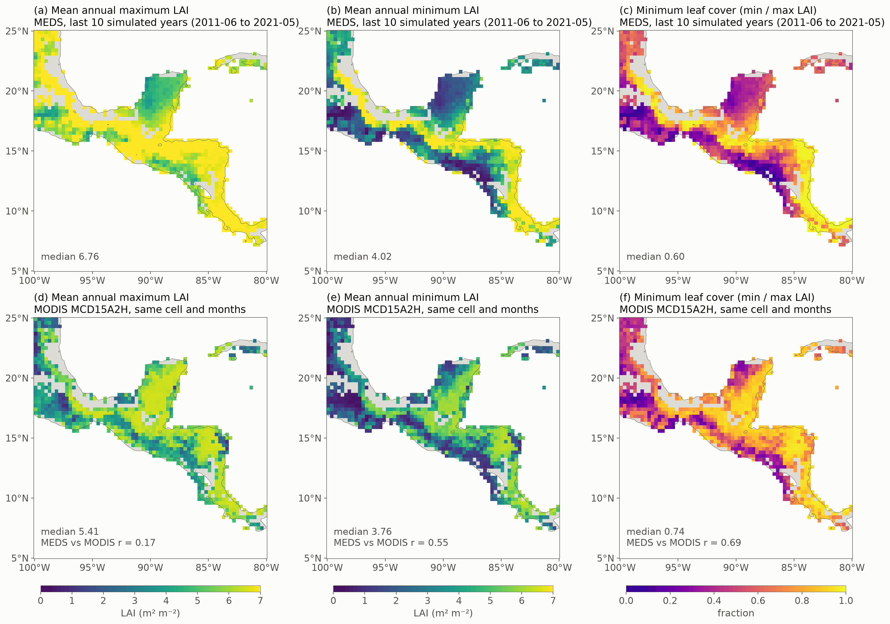
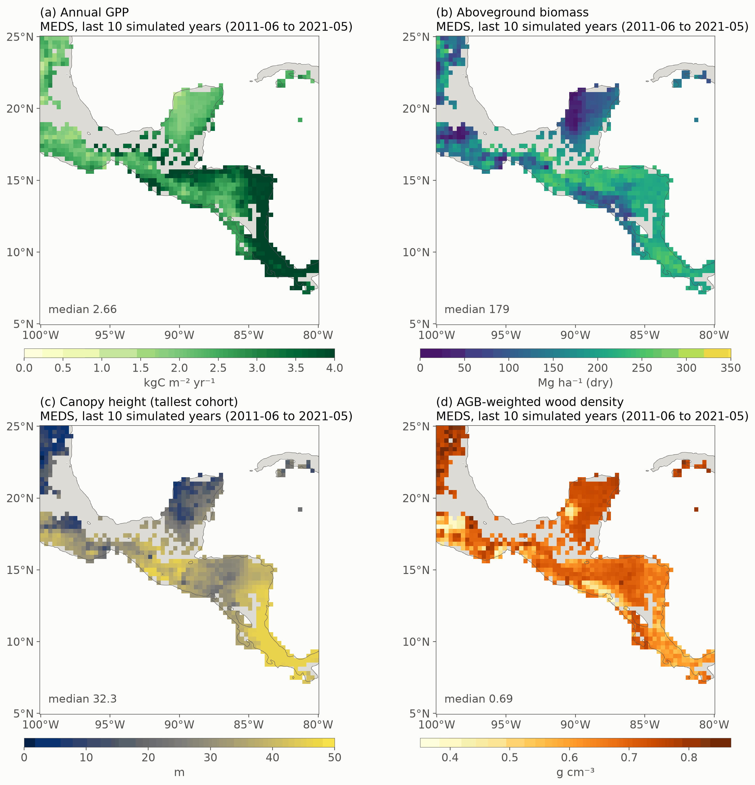
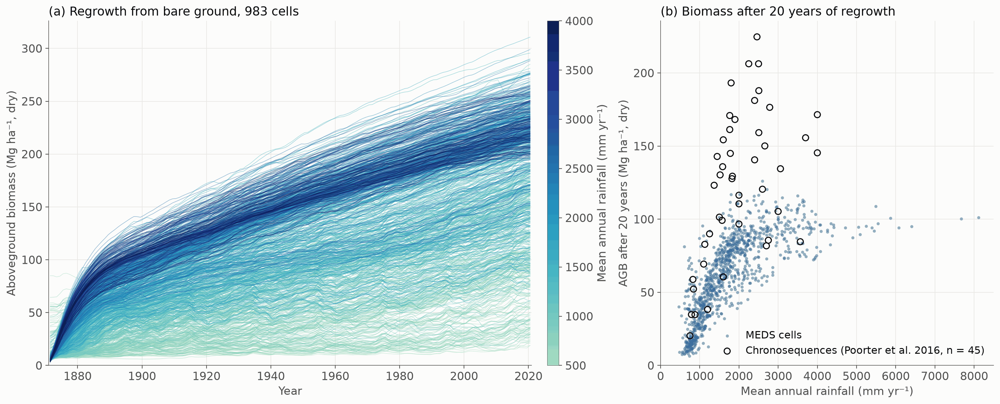

# Example 06 — A regional run: dry-forest leaf habits across Central America

Xu et al. (2016, *New Phytologist* 212: 80–95) explained the seasonality of leaf area across the
seasonally dry tropical forests of Central America with four plant functional types that differ in wood
density and hydraulic traits: deciduous with soft wood (Ds), deciduous (D), brevi-deciduous (BD) and
evergreen (E). This example tries the same with MEDS. One parameter set for the four PFTs, set at Palo
Verde (Costa Rica), regrows a forest from bare ground in 983 cells of their box. The last ten years of
each run are set against MODIS leaf area, and the same runs give the region's productivity, biomass,
canopy height and regrowth ([Additional results](#additional-results)).

814 of the 983 cells have finished; the figures and numbers below cover those.

Top: MEDS, the last ten simulated years (June 2011 – May 2021). Bottom: MODIS MCD15A2H at the same cell
and in the same months, whose weather drove those ten years. Columns: the mean annual maximum LAI, the
mean annual minimum LAI, and the minimum leaf cover (mean minimum / mean maximum). Both are made the same
way: monthly mean LAI, the maximum and minimum of the twelve months of each June–May year, and the means
of those over the ten years. A MODIS month is the mean of the cell's 8-day composites centred in it; each
composite is the mean of the cell's 500 m pixels that pass the QC filter and a 3-point running median,
and counts when at least a quarter of the pixels do. A year counts with at least six such months, a cell
with at least three such years; 33 cells have fewer (most lie on a coast or in Costa Rica and Panama)
and are blank in the MODIS row. Each simulated cell is drawn as the 0.3° block (3 × 3 ERA5-Land cells) it stands for; grey is
land with no simulated cell. The leaf cover follows the rainfall as MODIS's does (r = 0.71 across
cells); the peak leaf area is too high and too even (median 6.6 against 5.2, r = 0.13).

## The regional run

**Cells.** Xu et al.'s box, 5–25° N and 100–80° W, on the ERA5-Land 0.1° grid (201 × 201 cells, 10,512 on
land), cut into 3 × 3-cell blocks from its south-west corner. In each block the cell with the most natural
vegetation (ESA CCI 2001–2020, via the ED soil maps' diagnostics) runs, if it is at least 80 % natural:
994 cells. Eleven, on islands or at the coast, have no ERA5-Land cell within 15 km, so **983 run**.

**Each cell** runs the same configuration, with only its location's inputs changed:

| | Setting | Source |
|---|---|---|
| Period | 150 years, June 1871 – May 2021, daily demography, 15-minute column | |
| Start | bare ground: 3 recruits m⁻² of each PFT at 1.5 m height | |
| Seed rain | 0.1 recruits m⁻² yr⁻¹ of each PFT | |
| Weather | hourly ERA5-Land at the cell, 2003–2022, repeated (model year Y reads 2003 + (Y − 2003) mod 20) | ED_ERA5land archive |
| CO₂ | the historical record | CMIP7 |
| Soil | the cell's depth and texture; one van Genuchten curve fitted to MEDS's pedotransfer function (Hodnett & Tomasella 2002, Ottoni et al. 2019) on the six SoilGrids layers; CLM5 thermal properties; deep soil at the cell's mean air temperature + 1 K | ED soil maps v2 |
| Height | Chave et al. (2014) eq. 6a with the cell's stress index E; a cell the E map leaves empty takes the nearest value (four cells, 0.1° away) | Chave et al.'s E raster |
| PFTs | [`pft_parameters.toml`](pft_parameters.toml): wood density 0.35 / 0.52 / 0.74 / 0.87 g cm⁻³; leaf shedding and flushing on the cohort's leaf water potential; mortality from wood density (Camac et al. 2018); diameter growth capped at 0.8 / 0.5 / 0.4 / 0.35 cm yr⁻¹ | set at Palo Verde (below) |
| Disturbance | treefall opens 1.4 % of the ground a year; trees above 10 m die in the gap | |
| Output | monthly: LAI and AGB and GPP by PFT, site LAI and GPP, canopy height (the tallest cohort), trees ≥ 10 cm | |

**Speed.** One cell is one single-core task (peak memory under 70 MB). A run takes 0.2–14 hours (median
3.7). The cost follows the stand: about 0.24 s of compute per cohort per simulated year, and a wetter
cell grows more cohorts — about 40 below 1,000 mm of rain a year against 650 above 2,500 — so the driest
cells take half an hour and the wettest 10–14 hours. The 983 cells take about 5,100 core-hours, a day on
the 304 cores of the lab's cluster.

## Additional results

The last ten simulated years (June 2011 – May 2021): (a) GPP, (b) aboveground biomass (dry mass, all
stems), (c) canopy height (the tallest cohort) and (d) wood density, the PFTs' weighted by their AGB.
From the driest cells to the wettest, GPP doubles and the canopy grows from about 13 to 46 m, while AGB
levels off at 210–220 Mg ha⁻¹ above about 1,500 mm of rain. Brevi-deciduous trees hold most of the
biomass in three cells of four, and wood density falls with rainfall (0.74 to 0.61 g cm⁻³) as the
soft-wooded Ds gains a share.

(a) Each cell's AGB from the bare-ground start in 1871, coloured by its mean annual rainfall (ERA5-Land,
2003–2022). (b) AGB after 20 years against rainfall, with the 45 Neotropical chronosequences of Poorter
et al. (2016, *Nature* 530: 211–214; trees ≥ 5 cm in diameter) as open circles. Wet cells regrow fastest,
and nine in ten are still gaining after 150 years. MEDS is within the range of the dry chronosequences
but reaches about half the observed biomass above 1,200 mm; the diameter-growth caps, set for Palo
Verde's old stand, probably hold the young trees back. The few lines that start high are cells where a
1.5 m recruit is up to 3.5 cm in diameter.

## Palo Verde: the site check

[`meds_config_pv.toml`](meds_config_pv.toml) runs the 2009 inventory of the Palo Verde dry forest
([`data/pv_2009_census.csv`](data/pv_2009_census.csv): 6 plots, 12 patches, 336 cohorts) from July 2008
to December 2010 on the cell's ERA5-Land weather and soil, with the structure frozen (trees grow and die,
none recruit). The PFT traits were set against this stand:

| 2009–2010 | MEDS | Target |
|---|---|---|
| Leaf litter [kg dry m⁻² yr⁻¹] | 0.48 | 0.5 (litter traps 0.54) |
| AGB growth of trees ≥ 10 cm [kg dry m⁻² yr⁻¹] | 0.47 | 0.3–0.5 |
| Relative AGB growth, Ds / D / BD / E [% yr⁻¹] | 5.6 / 4.1 / 3.0 / 1.1 | 5 / 2–3 / 2–3 / 1–2 |
| Lowest leaf cover, Ds / D / BD / E | 0.02 / 0.00 / 0.33 / 0.75 | bare / bare / 0.25–0.5 / ≥ 0.5 |
| Stand LAI, March–April / wet season | 2.1 / 5.0 | MODIS 1.5 / 5.3 |
| Mortality of trees ≥ 10 cm, Ds / D / BD / E [% yr⁻¹] | 2.5 / 1.2 / 0.7 / 0.5 | 0.7–3.1 for the plots (Powers et al. 2020) |

From this folder, with the ED_ERA5land archive in place: `../../build-ifx/meds_main meds_config_pv.toml`.
