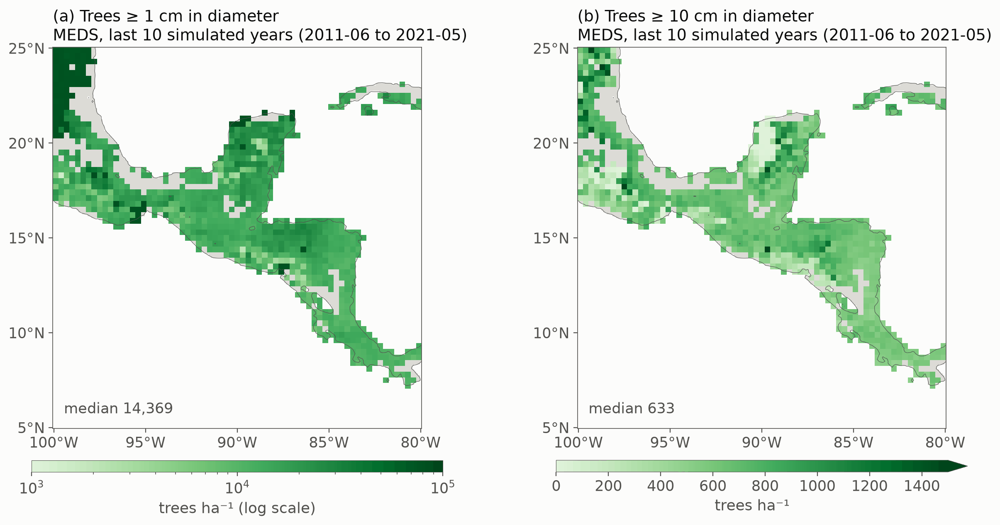
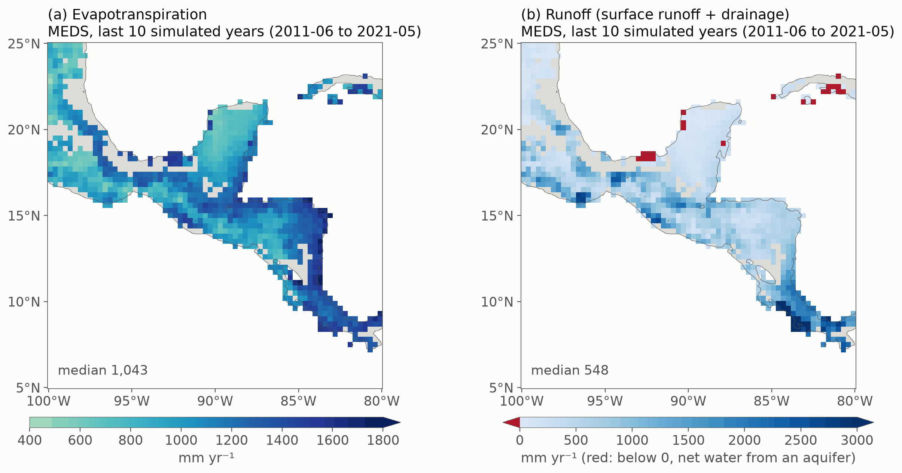

# Example 06 — A regional run: dry-forest leaf habits across Central America

Xu et al. (2016, *New Phytologist* 212: 80–95) explained the seasonality of leaf area across the
seasonally dry tropical forests of Central America with four plant functional types that differ in wood
density and hydraulic traits: deciduous with soft wood (Ds), deciduous (D), brevi-deciduous (BD) and
evergreen (E). This example tries the same with MEDS. One parameter set for the four PFTs, set at Palo
Verde (Costa Rica) in [example 05](../example05_forest_regeneration/README.md), regrows a forest from bare
ground in 953 cells of their box, run as two MEDS region runs. The last ten years are set against MODIS
leaf area, and the same runs give the region's productivity, biomass, canopy height, tree density, water
use and regrowth ([Additional results](#additional-results)).

The region runs, the figures and the numbers on this page were made with v0.3.4 and the region runtime that followed it; they were not repeated after the 2026-10 sweep.

Top: MEDS, the last ten simulated years (June 2011 – May 2021). Bottom: MODIS MCD15A2H at the same cell
and in the same months, whose weather drove those ten years. Columns: the mean annual maximum LAI, the
mean annual minimum LAI, and the minimum leaf cover (mean minimum / mean maximum). Both are made the same
way: monthly mean LAI, the maximum and minimum of the twelve months of each June–May year, and the means
of those over the ten years. A MODIS month is the mean of the cell's 8-day composites centred in it; each
composite is the mean of the cell's 500 m pixels that pass the QC filter and a 3-point running median,
and counts when at least a quarter of the pixels do. A year counts with at least six such months, a cell
with at least three such years; 16 cells have fewer (all in southern Nicaragua, Costa Rica and Panama)
and are blank in the MODIS row. Each simulated cell is drawn as the 0.3° block (3 × 3 ERA5-Land cells) it stands for; grey is
land with no simulated cell. The leaf cover follows the rainfall as MODIS's does (r = 0.68 across
cells); the peak leaf area is too high and too even (median 6.8 against 5.4, r = 0.14).

## The regional run

**Cells.** Xu et al.'s box, 5–25° N and 100–80° W, on the ERA5-Land 0.1° grid (201 × 201 cells), cut
into 3 × 3-cell blocks from its south-west corner. In each block the cell with the most natural vegetation
(ESA CCI 2001–2020, via the ED soil maps' diagnostics) runs, if it is at least 80 % natural; among equals,
the northern and then the eastern. A candidate must be a cell MEDS can run: valid forcing in the archive
and a value in every map the run reads. **953 cells**, written as a 0/1 mask on the forcing grid.

**The regions.** The cells run as two region runs, each a box of the mask on a machine of its own: 606
cells (13.15–25.05° N, 100.05–87.95° W) and 347 (7.25–23.05° N, 87.95–79.95° W). The split balances their
cost, not their counts: a wet cell grows many more cohorts and costs up to fifty times a dry one, so the
southern region holds fewer, costlier cells.

**Each cell** runs example 05's Palo Verde configuration, with its own location's inputs:

| | Setting | Source |
|---|---|---|
| Period | 150 years, June 1871 – May 2021, daily demography, 15-minute column | |
| Start | bare ground: 3 recruits m⁻² of each PFT at 1.5 m height (`nbg_init_density`) | |
| Seed rain | 0.1 recruits m⁻² yr⁻¹ of each PFT | |
| Weather | hourly ERA5-Land at the cell, 2003–2022, repeated (model year Y reads 2003 + (Y − 2003) mod 20), read from the archive by the region | ED_ERA5land archive |
| CO₂ | the historical record | CMIP7 |
| Soil | the cell's depth on MEDS's default layers; each layer's texture from the SoilGrids layers it overlaps, its van Genuchten curve and Ks from MEDS's pedotransfer function (Hodnett & Tomasella 2002, Ottoni et al. 2019), its thermal properties from CLM5 | ED soil maps v2 |
| Bottom boundary | the map's class: free drainage (892 cells) or an aquifer (61), a leaky base running as free drainage | ED soil maps v2 |
| Deep soil | the cell's mean air temperature + 1 K | ED soil maps v2 |
| Height | Chave et al. (2014) eq. 6a with the cell's stress index E | Chave et al.'s E raster |
| PFTs | example 05's [`palo_verde/pft_parameters.toml`](../example05_forest_regeneration/palo_verde/pft_parameters.toml): wood density 0.35 / 0.52 / 0.74 / 0.87 g cm⁻³; leaf shedding and flushing on the cohort's leaf water potential; mortality from wood density (Camac et al. 2018); diameter growth capped at 0.8 / 0.5 / 0.4 / 0.35 cm yr⁻¹ | set at Palo Verde ([example 05](../example05_forest_regeneration/README.md#2-palo-verde-a-tropical-dry-forest-150-years)) |
| Disturbance | treefall opens 1.4 % of the ground a year; trees above 10 m die in the gap | |
| Output | monthly, one file set per region with a `polygon` axis: LAI, AGB and GPP by PFT; site LAI, GPP, ET and runoff; canopy height (the tallest cohort); plant density in seven diameter classes (0, 1, 5, 10, 20, 50, 100, 1000 cm); each polygon's soil layers and map inputs | `io_config_region.toml` |

## Running it

Needs a built `meds_main`, numpy, netCDF4 and matplotlib, the ED_ERA5land archive, the ED soil maps and
Chave's E map; the MODIS step also needs an environment with GDAL's HDF4 reader and the MCD15A2H tiles.
The scripts take the data paths from `--era5-archive`, `--soil-maps` and `--chave-e-map`, or from the
environment: `ERA5LAND_ARCHIVE`, `ED_SOIL_MAPS`, `CHAVE_E_MAP`, and `MODIS_LAI_CODE` for the MODIS LAI
pipeline's code.

1. `python make_cell_mask.py` — the 953 cells: `output/cell_mask.nc` and `output/cells.csv`.
2. `python run_regions.py --regions 2 --threads 128 --cost cell_hours.csv --submit "sbatch --exclusive"`
   — writes the PFT file and one config per region (`output/region01/config.toml`, ...) and submits each
   region as a batch job of its own; without `--submit` they run here, one after another. `--cost`
   balances the regions by each cell's cost, here `cell_hours.csv`: the hours each cell took to run the
   150 years alone on one core in an earlier run (columns `lat, lon, cost`; a cell it lacks costs the
   median). Without it the regions get equal counts. `--years 1` makes a quick check of every cell's
   inputs.
3. `python summarize_regions.py` — per-cell summaries of the last ten years and the regrowth
   (`output/cells_summary.npz`), with each cell's 2003–2022 rainfall read from the archive.
4. `python modis_monthly_lai.py --workers 9` (GDAL environment) — MODIS monthly LAI at the cells.
5. `python plot_regional.py` — the five figures.

**Thread stack.** A region steps each polygon on an OpenMP worker thread, and a worker thread's stack is
`OMP_STACKSIZE` — 4 MB by default with ifx — not the process's (which a site run uses). A grown stand's
automatic arrays overflow 4 MB after a few decades of regrowth, and the run dies with a segmentation
fault. `run_regions.py` sets `OMP_STACKSIZE=512M` for every region (`--stack`); it only reserves address
space, and a thread uses what it touches. When running `meds_main` on a region by hand, export it first;
MEDS warns at a region's open when it is not set.

**Restarts.** Each region writes a state file every 25 years (`<region>-S-<date>.nc`). To resume a region
from one, set `[init] init_mode = 2` and `restart_file` to it, and give `[output]` and `[state]` a new
`prefix`, so the original monthly file is kept; the resumed run repeats the original's months bit for bit
and `summarize_regions.py` joins a region's monthly files by month.

## Speed and resources

Each region ran alone on a machine with an Intel Xeon Gold 6430 (2 sockets × 32 cores × 2 hardware
threads = 128 threads, up to 3.4 GHz) and 251 GB of memory. Each region used 128 OpenMP threads
(`OMP_PLACES=threads`, `OMP_PROC_BIND=close`, `OMP_STACKSIZE=512M`); the second hardware thread of each
core adds about 10–18 % over 64 threads.

| | Region 1 | Region 2 |
|---|---|---|
| Cells | 606 | 347 |
| Wall time, 150 years | about 26 h | 26.0 h |
| Threads busy, whole run (of 128) | 112 (88 %), from its 1921 state file on | 105 (82 %) |
| Threads busy, model year 2012 (about 2 h before the end) | 123 | 109 |
| Memory, model year 2012 | 4.2 GB resident | 3.7 GB resident |
| Peak memory | 4.4 GB | 3.9 GB |
| Reading the forcing | 15 min (from 1921) | 17 min |

Both regions together took about 5,500 hardware-thread hours. A region's threads take its polygons
costliest first, and every month ends when its slowest polygon does, so a region with few, costly
polygons keeps fewer threads busy. Memory grows with the stands, about 4 GB per region at the end; the
virtual size (75 GB) is the threads' reserved stacks. The first pass through the 20-year weather window
reads each month from the archive (about a minute per model year); after it the operating system's page
cache serves the re-reads (6–13 s per model year). A region's state file (250–360 MB) takes 10–15 s to
write. The monthly output is 100–180 MB per region.

## Additional results

The last ten simulated years (June 2011 – May 2021): (a) GPP, (b) aboveground biomass (dry mass, all
stems), (c) canopy height (the tallest cohort) and (d) wood density, the PFTs' weighted by their AGB.
From the driest tenth of the cells (below 800 mm of rain a year) to the wettest (above 3,100 mm), GPP
doubles (1.8 to 4.1 kgC m⁻² yr⁻¹) and the canopy grows from about 9 to 46 m, while AGB levels off at
about 215 Mg ha⁻¹ above 1,500 mm. Brevi-deciduous trees hold most of the biomass in three cells of four,
and wood density falls with rainfall (0.74 to 0.61 g cm⁻³) as the soft-wooded Ds gains a share (2 % of
the AGB in the driest tenth, 30 % in the wettest).

The last ten years: (a) trees at least 1 cm in diameter per hectare (log scale) and (b) trees at least
10 cm. Small stems dominate the counts: a cell holds a median 14,400 stems ≥ 1 cm per hectare and 630
≥ 10 cm, about 23 to 1. The dry cells hold the most small stems (a median 33,700 ha⁻¹ in the driest
tenth against 11,200 in the wettest): the 94 cells above 50,000 ha⁻¹ are dense, low stands (a median 9
m tall, 840 mm of rain), most in the north of the box. Trees ≥ 10 cm vary little with rainfall (medians
640 and 580 ha⁻¹) and are fewest, below 200 ha⁻¹, in 68 dry cells.

(a) Each cell's AGB from the bare-ground start in 1871, coloured by its mean annual rainfall (ERA5-Land,
2003–2022). (b) AGB after 20 years against rainfall, with the 45 Neotropical chronosequences of Poorter
et al. (2016, *Nature* 530: 211–214; trees ≥ 5 cm in diameter) as open circles. Wet cells regrow fastest,
and every cell is still gaining after 150 years. MEDS is within the range of the dry chronosequences but
reaches about 60 % of the observed biomass above 1,200 mm (median 79 against 138 Mg ha⁻¹); the
diameter-growth caps, set for Palo Verde's old stand, probably hold the young trees back. The few lines
that start high are the hottest, driest cells, where a 1.5 m recruit on Chave's curve is up to 3.6 cm in
diameter.

The last ten years: (a) evapotranspiration and (b) runoff, the pond's spill plus the drainage through
the soil column's bottom, in mm a year. A cell evaporates a median 68 % of its rain (1,040 mm) and loses
34 % as runoff (550 mm). ET rises with rainfall, from 660 mm in the driest tenth to 1,370 mm in the
wettest, but takes a falling share of it (94 % to 37 %); runoff follows the rain (r = 0.97), from 80 mm
to 2,140 mm, and is highest on the Caribbean slope of Costa Rica and Panama. On the 61 cells over an
aquifer the bottom boundary feeds the column in the dry season, and their ET is higher (median 1,480
mm). Red marks the 22 of them where more water rose from the water table than drained to it over the
decade (western Cuba, the Tabasco lowlands and the Yucatán's coast): dry sites over shallow groundwater,
which the aquifer keeps leafy through the dry season.
